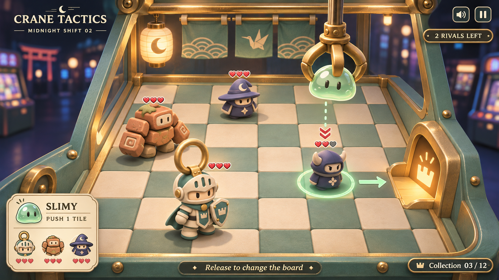

# Midnight toy theatre — visual target v1

Requested by the owner on 2026-11-06 JST: cute, fun, tactically substantial, and inviting to master. Generated with native ImageGen, using the owner's Knight turnaround as a character reference. This is a concept image, not implementation or performance evidence.

## Adopt

1. An intimate teal-and-brass miniature cabinet in a dark midnight arcade. Warm light belongs to the toys and chute; the outside world remains subdued.
2. Expressive collectible toys: ivory/teal Ring Knight, terracotta Heavy, mint Slimy. Large forms first, decorative detail second. Collision proxies remain independent.
3. The board dominates the frame. One compact ability/roster cluster at lower-left, objective at upper-right, a small release hint. No central permanent overlays.
4. Spatial tactical cues: uncertain landing footprint, a real arrow for slime push, provisional enemy intent, nearby health pips. Different colors and shapes, not color alone.
5. A collection/medal loop is a future direction: reward different solutions and personal improvement, not grinding or paid power. For this slice, keep the three-friend recruitment arc and local best-drop records.

## Do not import image errors as rules

The image is illustrative: exact tile count, enemy HP, roster portraits and the `03 / 12` collection counter are not authoritative. In particular, the roster's wizard portrait is an image-generation inconsistency; the playable third friend remains Slimy. No extra unit, shop, live service or twelve-character roster is promised by this image.

## Implementation checkpoints

- Preserve the verified 6×6 battle / 4×4 Prize board, turn rules and two-drop Battle 2 solution.
- Bring camera, warm material separation, toy silhouettes, cabinet framing and low-density HUD closer to the image.
- Recheck real physics after presentation changes. Compare fresh runtime captures with the image for silhouette, occlusion, chute visibility, health readability and playable space.
- Continue model details and the longer collection/progression loop only after the first complete slice is comfortable to play. An attractive concept is not a claim that the current build matches it.

## Generation brief

Native ImageGen; reference: `ArtSource/References/Knight.png` (local owner source). Prompt: polished wide Unity 3D tactical claw-game screenshot, midnight arcade, cream/teal/brass cabinet, readable 6×6 board, ring Knight + terracotta Heavy + carried mint Slimy, two indigo rivals, glowing collection chute, one landing disk and push arrow, health hearts, small typography and compact roster UI; no store, dashboard, dense hotbar or obstructing overlays. Exact title: CRANE TACTICS. Source output retained at the tool's generated-image location; selected output copied here.
