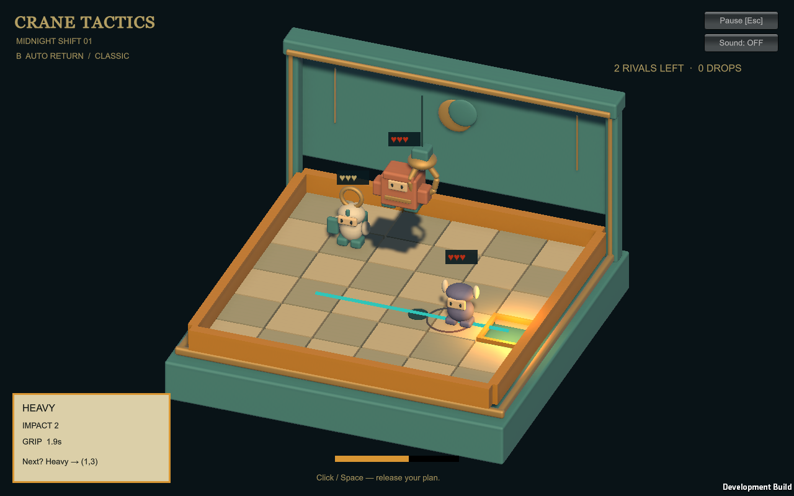
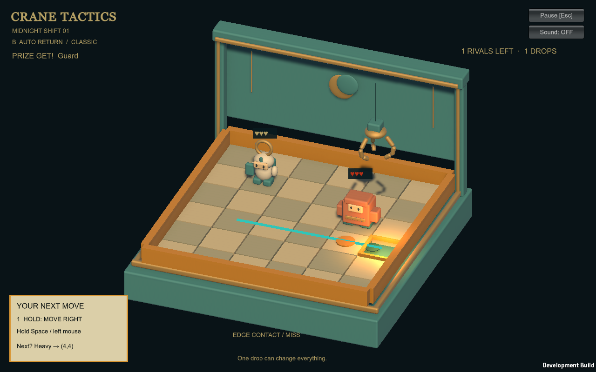
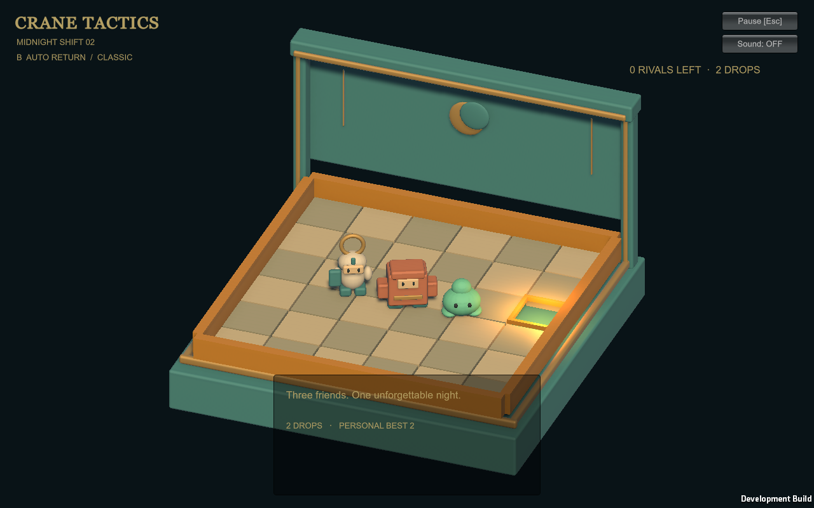

# Auto Return experiment v0.2

Experimental branch based on PR #3, `2e4a7fc`. Unity **6000.3.9f1** / URP; no engine upgrade, main merge, publication or distribution. The existing checkout was clean and already imported, so it was reused instead of creating another multi-GB Unity Library.

## Play

Launch `Builds/Windows/CraneTactics.exe`, or open the OneNight scene and Play.

- Default **A / FREE CARRY** preserves the existing mouse / WASD / Space mode.
- Esc → **Experiment A → B** resets to the same Battle 1 layout and objectives.
- **B / AUTO RETURN:** hold Space or left mouse to move right, release to lock X; hold again to move into the cabinet, release to lock Z and descend. A locked axis cannot reverse. Releasing at the edge still locks that axis. The mouse cursor does not freely steer B.
- The floor line previews horizontal-then-depth return to the chute. The ground disc tracks the claw and the gold footprint estimates the landing from swing velocity. The landing estimate is approximate: collisions and rebounds can change it.
- During automatic return, click / Space to release. Otherwise the claw brakes at the chute and releases after the load settles. Grip expiry releases automatically. Esc pauses movement and the grip clock.
- Pause controls also select the three tactical cases, Koromochi, and CLASSIC / SWEETS floor. Each selection resets the cabinet. They do not replace the default One Night layouts.
- Save input/result log writes `crane-experiment.jsonl` to Unity's `Application.persistentDataPath`. Development playback exports directly into its evidence folder.

## Rules and implementation

`BoardState` remains the sole board authority. Success release, grip break, empty miss and failed contact each commit one action; revision tokens reject duplicate or cancelled resolutions. Normal Knight attack and one enemy turn still follow the result. A surviving enemy Heavy also takes that normal enemy turn.

Mode B grab success is deterministic and uses the horizontal offset from a per-character contact proxy: Knight radius .55, Heavy .38, Slimy .48, Koromochi .24. Quality below .30 slips. This is a readable geometry approximation, **not** a simulated multi-finger force/torque solver or a mesh-level ring catch. Central aim is stable; poor edge contact is visible in the aim hint.

Base hold times are Slimy 5s, standard 3.8s, Heavy 2s, Koromochi 1.2s, multiplied by .65–1.6 according to grip quality. B's clock starts after lift, so descent/lift distance does not silently penalize heavy toys. Return speed is 1.7 units/s. Heavy can cross less distance; its impact remains 2 damage. A retains its old hold timing and values.

PhysX carries the released Rigidbody's momentum and reports its first toy collision. B uses that observed target's cell for the tactical impact, or the settled center when no toy was hit. HP, push, captures and turns resolve once after settlement. B solid impacts first damage, then push a surviving target along release direction where possible, including into the chute. A retains its original neighboring-cell displacement. The two-second settling fallback remains. Soft toys have a bounce material in B; tactical push still resolves once.

Failed contact pushes a non-Heavy toy one unoccupied cell away from the claw, including into the chute. A Heavy stays in its cell and visibly turns. Wall/occupancy blocks movement. This is a discrete contact result; it does not claim continuous rolling of every unheld piece. Koromochi is an isolated pink round prototype with narrow grasp tolerance and short grip: edge pushing is more reliable than carrying it far.

`ReturnRoute` stores ordered waypoints. `CabinetProfile` separates immutable CLASSIC/SWEETS speed/friction/bounce data. SWEETS reduces floor friction; sticky obstacles and MAGNET LAB are not implemented. `ClawActivity` exposes a small typed event seam for approach, success/failure, release/grip break, impact, settle and capture. There is no new global event bus or second board.

Enemy captures are recorded in `BoardState.Captured`; they are not added to Prize Chance's roster. Slimy recruitment and the three-friend ending remain intact. Petapetan and Clockwork Robot are deferred to keep this experiment focused.

## Tactical cases

- **A:** hostile Heavy at (1,2), Guard HP 3 at (4,2), chute (5,2). Grab Heavy centrally and release while its head passes approximately X=3.15. Swing and fall carry it into Guard; damage plus directional push can capture Guard. The surviving Heavy acts afterward.
- **B:** Guard near the chute. Center grip and hold through the return.
- **C:** Scout at (4,2), chute (5,2). Aim approximately (3.55,2): poor grip nudges Scout into the chute. This demonstrates a useful failure without phantom drop damage.

## Evidence and comparison boundaries

Automated playback uses the real Unity player and PhysX, but programmatic inputs; it does not establish human enjoyment, blind usability, physical keyboard/mouse comfort or speaker sound.

Verified locally on 2026-11-07 JST:

| Check | Result / evidence |
| --- | --- |
| Baseline before the experiment | Independent rules 36 assertions, including 100 seeded runs; original PlayMode 5/5 |
| C# compilation | Final official CLI Windows build reports `editorErrors: []` |
| EditMode | **10/10**, including route, grip boundaries, miss/cancel/duplicate behavior, directional capture, 100 seeded failed-contact reproductions and profile differences; `artifacts/EditMode.xml` |
| PlayMode | **11/11**, including original five tests, B full One Night, actual Heavy collision→Guard chute capture, exact one-turn capture/miss, sequential input and paused grip; `artifacts/PlayMode.xml` |
| Windows development build | Succeeded using Unity CLI beta.13 / Editor 6000.3.9f1; `artifacts/auto-build-final.log` and provenance JSON |
| A player regression | Full loop with Prize miss/retry and replay PASS; `artifacts/free-carry-comparison/result.txt` |
| B player regression | Full loop, enemy Heavy impact and useful failed-contact capture PASS; final capture folder listed below |
| Media | Actual rendered player PNGs, visually inspected; fixed-20-fps MP4s; not reconstructed scenes |
| MADO service | Actual `run_gameplay_capture` PASS against factory commit `11c0a0e5043de89806052af00ac7158962d5ad00`; no subjective friction report fabricated |
| Normal OS keyboard/mouse | **Not verified**: Computer Use app launch approval timed out; no substitute claim from scripted inputs |
| Human enjoyment, audio comfort, FPS budget | **Not verified** |

Initial scripted comparison: A six actions median **4.75s**, B six actions median **5.65s** from approach to result. A had one hold-limit release; B had zero. These runs use different routes and programmed waits, and are not a controlled input-speed or accidental-drop study. Input selection time is excluded. The final B route display/home-return polish was subsequently re-recorded.

Local deliverables:

- `Builds/Windows/CraneTactics.exe` — local development build, not distributed.
- `artifacts/auto-return-verified/` — final B PNGs, timeline, input/result JSONL, capture manifest and MADO result.
- `artifacts/auto-return-playthrough.mp4` — B complete loop and tactical cases.
- `artifacts/auto-return-five-seconds.mp4` — the Heavy release/impact/capture segment.
- `artifacts/free-carry-playthrough.mp4` — A reference playback.

Review in the Editor: try the actual two-hold input without instructions; judge the central/edge grip hint; release Heavy early/late over Guard; let grip expire; pause/resume mid-flight; compare A/B from a fresh identical Battle 1; try blocked missed-contact pushes; test SWEETS slides and Koromochi. Inspect the bounce/landing forecast mismatch. Target pushes currently snap at resolution instead of visibly rolling into the chute: this limits the impact's physical readability and is a priority presentation follow-up.

The strongest current design finding is that central enemy captures are reliable enough to finish both battles without using impact tactics. Keep this visible in A/B testing rather than hiding it with a new prohibition. The next valuable experiment is a human comparison of the same Battle 1: time per action, unintended drops, useful missed grabs, capture dominance, explanation needed, and recognition of the action in a five-second clip. Do not infer human surprise/confusion scores from automated success.

## Referenced tools

- [text-to-cad](https://github.com/earthtojake/text-to-cad): inspected its current workflow. It produces fabrication-oriented CAD and mesh exports; no CAD generation or global installation was performed. Existing Blender cabinet and character references remain unchanged. CAD tooling is not required for this control experiment.
- [MADO Game Service Factory](https://github.com/madowaku/mado-game-service-factory): `scripts/capture_evidence.py` adapts real Unity PNGs and input/result events to its capture contract, preserves timestamps and SHA-256, and optionally runs its actual service from a local checkout. No uploads or invented friction ratings.
- [Scenario Unity expert](https://github.com/scenario-labs/skills/blob/main/skills/game-engines/unity/scenario-unity-expert/SKILL.md): used its evidence-review principles. Its bundled toolkit is macOS-oriented; not installed. Scenario generation MCP is not exposed in this chat.
- [Unity official Codex plugin](https://unity.com/ja/blog/unity-plugin-codex): the local plugin and CLI 1.0.0-beta.13 exist. `unity status --json` found no connected Pipeline instance; the project's manifest has no Pipeline dependency. Batch Editor tests and official CLI build are separate from an MCP/live Editor connection. The sandboxed update check could not resolve the Unity CDN. The successful elevated build later reported beta.17 available with `requiresUserApproval: true`; no upgrade was performed or needed to complete this experiment. The first sandboxed CLI build stalled on license hardware-information access; the same build succeeded with escalation.

## Specification differences

- `CODEX_HANDOFF.md` current-evidence introduction still describes the historical documentation-only main. Actual PR #3 supplies the Unity project; followed the verified checkout.
- `CODEX_HANDOFF.md` v0.1 reliable grab / free carry / hold table applies to A. The explicit new mission authorizes deterministic contact grasping, automatic return and quality-dependent grip in B; original behavior stays available.
- `CODEX_HANDOFF.md` solid survivor displacement chooses a neighboring empty cell. B's explicit push/capture mission extends this to directional chute pushes; A is unchanged.
- `VISION.md` remains an ideal illustration, not a fresh capture or roster specification. Followed its preservation of Knight, Heavy and Slimy and its camera/readability priorities; no claim of full visual parity.

## Reproduce

```powershell
dotnet run --project Tests/Rules/Rules.csproj
./scripts/verify.ps1 -Editor '<Unity 6000.3.9f1 Unity.exe>' -Mode EditMode
./scripts/verify.ps1 -Editor '<Unity 6000.3.9f1 Unity.exe>' -Mode PlayMode
unity build . --target StandaloneWindows64 --execute-method CraneTactics.Editor.BuildOneNight.BuildWindows --allow-dirty-build --no-tail --log-file artifacts/auto-build.log
./Builds/Windows/CraneTactics.exe --auto-output '<absolute evidence directory>'
python scripts/capture_evidence.py artifacts/auto-return-capture --mgsf-source artifacts/mado-game-service-factory/src
```

Run player capture with a visible render surface; blank/hidden captures are not accepted. Fixed 20-fps recording is not a performance benchmark.

Visual correction: the first unlit route change passed compilation but appeared magenta in the Windows player because a runtime-only Shader.Find reference did not preserve its shader in the build. That capture was rejected. `Resources/RouteGuide.mat`, generated by the build preparation step, now explicitly carries the unlit shader into the player. The final verified recording supersedes `artifacts/auto-return-final/`.






