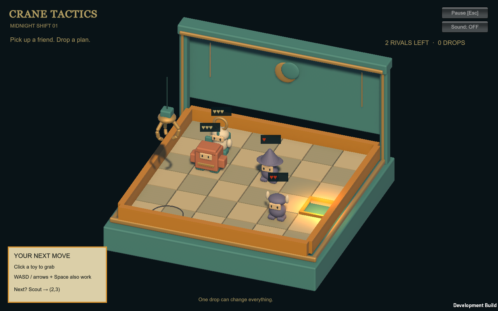
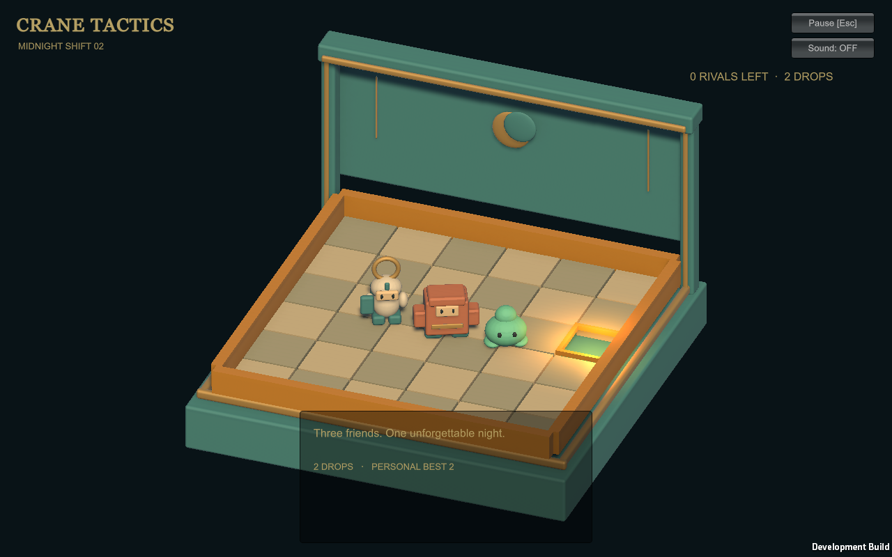

# One Night local validation

For the v0.2 experimental branch and its separate A/B evidence, see [AUTO_RETURN_EXPERIMENT.md](AUTO_RETURN_EXPERIMENT.md). The counts below describe the original v0.1 baseline, not the latest experimental suite.

This is a playable prototype, not a release or proof of the ideal concept's visual fidelity. Evidence is local under ignored `artifacts/`; no build has been published.

## Passed checks

- Engine-independent .NET rule runner: **36 assertions**, including 100 seeded random runs for occupancy and one-release/one-action invariants. Battle 1 collection route and Battle 2 two-drop route pass.
- Unity EditMode: **3/3 passed** (`artifacts/editmode.xml`).
- Unity PlayMode after final visual changes: **5/5 passed** (`artifacts/review-playmode.xml`): real PhysX full loop with Prize miss/retry, enemy timeout, pause freezes carry clock, screen-ray selection reaches carry, and visible swing velocity transferred into a dynamic Rigidbody release.
- Unity compilation, OneNight scene creation, FBX one-metre size probe, and Windows x64 development build passed.
- Final Windows executable ran the real crane/PhysX full loop, including Prize miss, recruitment, Battle 2 and replay (`artifacts/review-capture/result.txt`, `timeline.txt`). Input for that run was programmatic, not a human or GUI playthrough. All timeline checks passed; 687 rendered frames form an approximately 34-second fixed-20-fps video at `artifacts/one-night-playthrough.mp4`.
- Final Unity build log: `artifacts/build-final.log`; size probe `(1,1,1)` and directional probe `(+1,0,0) / (0,0,-1)` both pass. Latest first-shift, recruitment and ending captures were visually inspected: cabinet alignment, toy facing, board visibility and health contrast were corrected. This remains simplified prototype art.





## Defects found and addressed

- Initial Editor license failure: resolved after owner sign-in; initial exit 198 is retained in the first launch log history only.
- Camera/listener instances remained between PlayMode tests: made runtime-created camera/light children of the game, tagged the camera correctly, and reran tests.
- Synthetic Input System mouse events did not reach gameplay in headless tests even though the selection ray hit the toy. The stable automated test now exercises the shared screen-position/raycast entry point directly. This does **not** prove normal OS mouse event delivery. Computer Use app access timed out, so hands-on mouse acceptance remains open.
- Hidden-player ScreenCapture images were black: rejected those images. Visible-window captures produced actual rendered frames.
- First rendered pass revealed backwards-facing toys and a cabinet offset from the board despite passing the size probe. Corrected the FBX export axis contract and added a directional probe before accepting exports.

## Evidence boundaries / remaining checks

- No connected Unity or Blender MCP was available; CLI/background execution was used under the handoff's fallback.
- Gameplay screenshots and recorded automatic playback are machine-driven evidence, not user playtest feedback.
- Speaker audio, physical mouse/keyboard comfort, long-session play, and hardware performance remain unverified.
- Heavy/Slimy/cabinet original Library sheets remain uninspected. The generated concept and written identities guide simplified original meshes.
- Higher-detail materials, effects, broad collection progression, and the full visual target are continuing art/game-design work. The collection count in the concept is not implemented content.

## Reproduction

```powershell
dotnet run --project Tests/Rules/Rules.csproj
./scripts/verify.ps1 -Editor '<installed Unity.exe>' -Mode EditMode
./scripts/verify.ps1 -Editor '<installed Unity.exe>' -Mode PlayMode
./scripts/verify.ps1 -Editor '<installed Unity.exe>' -Mode Build
./Builds/Windows/CraneTactics.exe --smoke-output '<absolute evidence folder>'
```

Run the capture visibly. The development-only smoke driver saves screenshots, timeline, result and a fixed-20-fps frame sequence. This is video evidence, not a measured frame-rate benchmark.

## Specification differences

- README original concept: 5×5, difficult grasping, initial one-scene experiment. Followed the handoff's explicit newer 6×6 / 4×4, reliable automatic grab and full One Night loop; README now labels its older section accordingly.
- Handoff Battle 2 HP table versus reference route: owner authorized balancing; Battle 2 Scout now has HP 2 and attack 2. Battle 1 retains HP 1 and attack 1. Both code and handoff record the decision.
- Browser study versus design draft: followed the handoff's attack-first planner, 4×4 Prize and Study 03 placement; did not import the older rotating enemy actor or three-drop route.
- Ideal image's roster/HP/collection count versus implemented rules: image remains an illustrative target; `VISION.md` explicitly identifies its mismatched wizard portrait and unimplemented twelve-character collection count.
